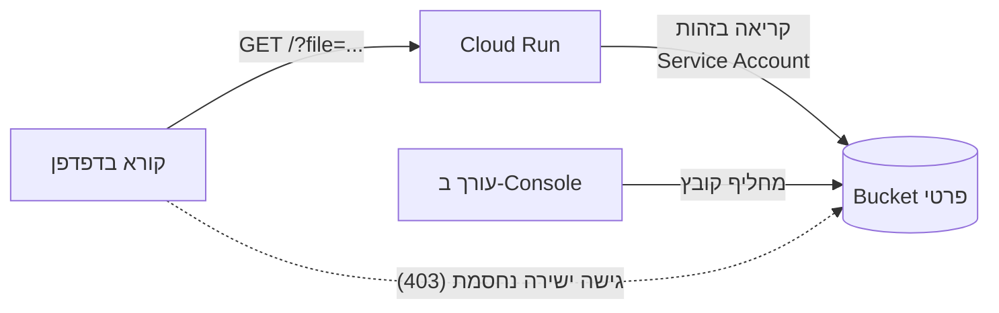
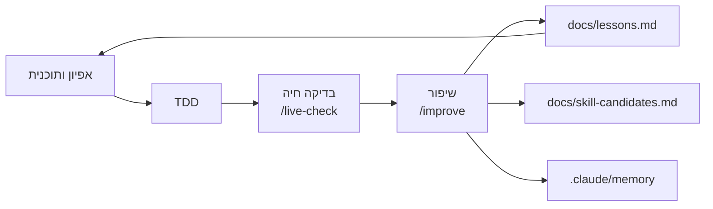

# intro_to_gcp

דף ב-Cloud Run שקורא קובץ מ-Bucket פרטי ב-Cloud Storage בכל טעינה. מחליפים את הקובץ, מרעננים, ורואים תוכן חדש בלי deploy.

## מה מיוחד כאן

- **הדף מוכיח את עצמו:** בתחתית מוצגים `generation` של הקובץ ושם ה-revision. בהחלפת קובץ הראשון משתנה והשני לא, וזו ההוכחה שהתוכן מגיע מה-Bucket.
- **ה-Bucket פרטי:** גישה ישירה מחזירה 403. השירות קורא בזהות Service Account, עם הרשאה על ה-Bucket בלבד.
- **אין מפתחות סודיים:** הגישה ל-Google היא בזהות ולא בקובץ. [הסבר](docs/runbook.md#סודות-וזהויות).
- **כל תקלה מקבלת טיפול משלה:** קובץ חסר מציג מצב המתנה שמתאושש לבד, תקלת הרשאות אומרת שניסיון חוזר לא יעזור, ו-CSV שבור מציין את מספר השורה.
- **הפורמטים נבחרו לפי הקורא:** `txt`, `md` ו-`csv` נבנו, `docx` הבא בתור, ו-`json` נדחה למרות שהוא הכי קל. [הנימוקים](docs/decisions.md).

## איך זה עובד



## הרצה

**צריך:** פרויקט Google Cloud עם חיוב פעיל, `gcloud` מחובר (`gcloud auth login`) ו-Python 3. אין צורך ב-Docker, כי Cloud Build בונה את התמונה.

**1. התקינו והריצו בדיקות:**
```bash
git clone https://github.com/almaya-ai/intro_to_gcp.git
cd intro_to_gcp
python3 -m venv .venv
.venv/bin/pip install -r requirements.txt pytest
.venv/bin/python -m pytest
```

**2. הגדירו את הפרויקט שלכם.** העתיקו את קובץ ההגדרות ומלאו בו `PROJECT` ו-`BUCKET_NAME`. שם Bucket חייב להיות ייחודי בכל Google Cloud:
```bash
cp env.example .env
```

**3. פרסו.** הפעולה הראשונה לוקחת כמה דקות. בסוף מודפסת כתובת השירות, והעתיקו אותה ל-`SERVICE_URL` ב-`.env`:
```bash
./deploy.sh
```

**4. העלו את הקבצים ופתחו את הכתובת.** אתם אמורים לראות "גרסה 1":
```bash
set -a; source .env; set +a
gcloud storage cp samples/*.* "gs://$BUCKET_NAME/" --project "$PROJECT"
```

**5. החליפו קובץ.** ב-Console העלו את `samples/v2/message.txt` באותו שם, ובחרו **Overwrite object**. ברענון מופיע "גרסה 2", עם `generation` חדש ואותו revision.

**6. בדקו קובץ חסר.** שנו זמנית את השם, רעננו, ואז החזירו. אם הלשונית גלויה, הדף חוזר לתוכן לבד תוך 15 שניות:
```bash
gcloud storage mv "gs://$BUCKET_NAME/message.txt" "gs://$BUCKET_NAME/message.txt.bak" --project "$PROJECT"
```
```bash
gcloud storage mv "gs://$BUCKET_NAME/message.txt.bak" "gs://$BUCKET_NAME/message.txt" --project "$PROJECT"
```

**7. בדקו הכול:**
```bash
python3 .claude/skills/live-check/check.py
```

**אם משהו לא עובד:** [טבלת התקלות](docs/runbook.md#פתרון-תקלות). אם הארגון שלכם מגביל גישה ציבורית, ייתכן ש-`--allow-unauthenticated` ב-`deploy.sh` לא יספיק, וצריך לפתוח את הכתובת בהזדהות.

**בסיום:** כדי שלא יהיו עלויות, מחקו את המשאבים לפי [הפירוק](docs/runbook.md#פירוק). **להרצה מקומית בלי פריסה:** [runbook](docs/runbook.md#הרצה-מקומית).

## פורמטים ותקלות

הוסיפו לכתובת `?file=` עם אחד מהקבצים ב-`samples/`:

| קובץ | מה רואים |
|---|---|
| `note.md` | הודעה מעוצבת. סקריפט שבתוך הקובץ מוצג כטקסט ולא רץ |
| `data.csv` | טבלה |
| `legacy.txt` | טקסט בקידוד `cp1255`, עם הערה |
| `broken.csv` | 422, עם מספר השורה הבעייתית |
| `image.txt` | 422, "נראה שזה קובץ בינארי" |
| `empty.txt` | "הקובץ ריק" |
| `report.pdf` | 415, עם רשימת הפורמטים הנתמכים |
| `missing.txt` | 404, מצב המתנה וספירה לאחור |

קובץ טקסט מעל 1MB מחזיר 413.

## מבנה

| נתיב | תפקיד |
|---|---|
| `main.py` | קריאה מ-GCS, טבלת מצבים, Flask |
| `parsers.py` | bytes ← תוכן להצגה או סיבת כישלון |
| `templates/page.html` | הדף, כולל ניסיון אוטומטי |
| `tests/` | בדיקות לקוד, ל-GCS, לתצורה ול-hooks |
| `samples/` | קובצי דוגמה; `v2/message.txt` הוא גרסה 2 |
| `deploy.sh`, `Dockerfile` | הקמה ופריסה |
| `env.example` | כל ההגדרות, בלי ערכים אמיתיים |
| [`docs/`](docs/README.md) | ארכיטקטורה, החלטות, תפעול ולקחים |
| [`CLAUDE.md`](CLAUDE.md) | הוראות עבודה ל-Claude Code: שפה, כלים, TDD, מסמכים, זיכרון |
| [`.claude/`](.claude/README.md) | הגדרות, hooks, skills, agents, כללים וזיכרון |

## דרך העבודה



מה שנלמד חוזר להוראות: הלקחים נטענים בכל סשן, פעולה שחזרה שלוש פעמים מוצעת כ-skill, וכלל שנשכח פעמיים הופך ל-hook.
