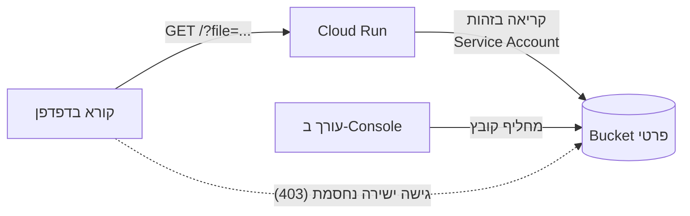
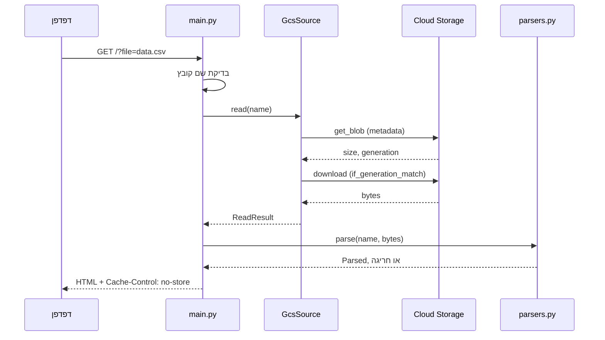

# ארכיטקטורה

## התמונה הכללית

שני אנשים עובדים על אותו קובץ בלי להכיר זה את זה: העורך מחליף אותו, והקורא רואה את התוכן החדש ברענון הבא. אין בניהם deploy, ולכן אין צורך במפתח כדי לעדכן תוכן.

## מה קורה בטעינת דף

שתי החלטות בזרימה הזו עושות את ההבדל:
- **הגודל נבדק לפני ההורדה.** קובץ גדול נדחה בלי לטעון אותו לזיכרון, וזה חשוב בשירות עם 256MB.
- **ההורדה מקובעת ל-`generation`.** אם הקובץ מוחלף בין שתי הקריאות, השירות מחזיר 503 וניסיון חוזר, ולא מציג תוכן חדש לצד מזהה ישן.

## מי אחראי על מה

| רכיב | תפקיד | לא מכיר את |
|---|---|---|
| `parsers.py` | bytes ← `Parsed` או חריגה מוגדרת | GCS, Flask, HTML של הדף |
| `GcsSource` ב-`main.py` | קריאה מ-GCS ותרגום חריגות Google לשפת השירות | פורמטים והודעות למשתמש |
| `STATES` ב-`main.py` | טבלה אחת: מצב ← קוד, הודעה, ניסיון חוזר | פרטי הקריאה |
| `templates/page.html` | תצוגה, RTL, ספירה לאחור וניסיון אוטומטי | מאיפה התוכן הגיע |

ההפרדה מאפשרת לבדוק כל רכיב בנפרד: `parsers` בלי ענן, `GcsSource` עם stub שזורק את החריגות האמיתיות של Google, והדף עם `FakeSource`.

## זהויות והרשאות

| מי | מה יש לו | למה |
|---|---|---|
| Service Account של השירות | `roles/storage.objectViewer` על ה-Bucket בלבד | הרשאה מצומצמת ככל האפשר בלי תפקיד מותאם |
| הציבור | `run.invoker` על השירות | הדף מיועד לקריאה בלי התחברות |
| הציבור מול ה-Bucket | כלום. Public Access Prevention אכוף | אי אפשר לפתוח אותו בטעות גם בהרשאה עתידית |

**המשמעות של גישה ציבורית:** השירות הוא השער ל-Bucket. כל קובץ בשם שטוח ובפורמט נתמך ניתן לקריאה דרך `?file=`, ולכן ה-Bucket ייעודי לתוכן להצגה. הנימוק ב-[decisions.md](decisions.md).

## פריסה

`deploy.sh` מקים את המשאבים אם הם חסרים, ואז מריץ `gcloud run deploy --source .`. Cloud Build בונה את התמונה מה-`Dockerfile`, כך שלא צריך Docker מקומי. ה-`Dockerfile` מעתיק רק את קובצי הריצה ורץ כמשתמש `nobody`.

| הגדרה | ערך | למה |
|---|---|---|
| `min-instances` | 0 | אין עלות כשאין תעבורה. המחיר: השהיה בכניסה הראשונה |
| `max-instances` | 2 | גבול לעלות, כי הכתובת ציבורית |
| `memory` | 256Mi | הקבצים מוגבלים ל-1MB |
| gunicorn | worker אחד, 4 threads | הקריאות ברובן המתנה לרשת |

## מה נשאר מחוץ לשירות

**אין שמירת מצב:** כל טעינה קוראת מחדש מ-GCS, בלי מטמון ובלי בסיס נתונים. מכאן שכל instance מציג אותו דבר, וזו הסיבה שאין צורך בתיאום ביניהם. המחיר הוא קריאה ל-GCS בכל טעינה, וזה מקובל בשירות קטן. בתעבורה גבוהה זה הדבר הראשון שכדאי לבחון.
